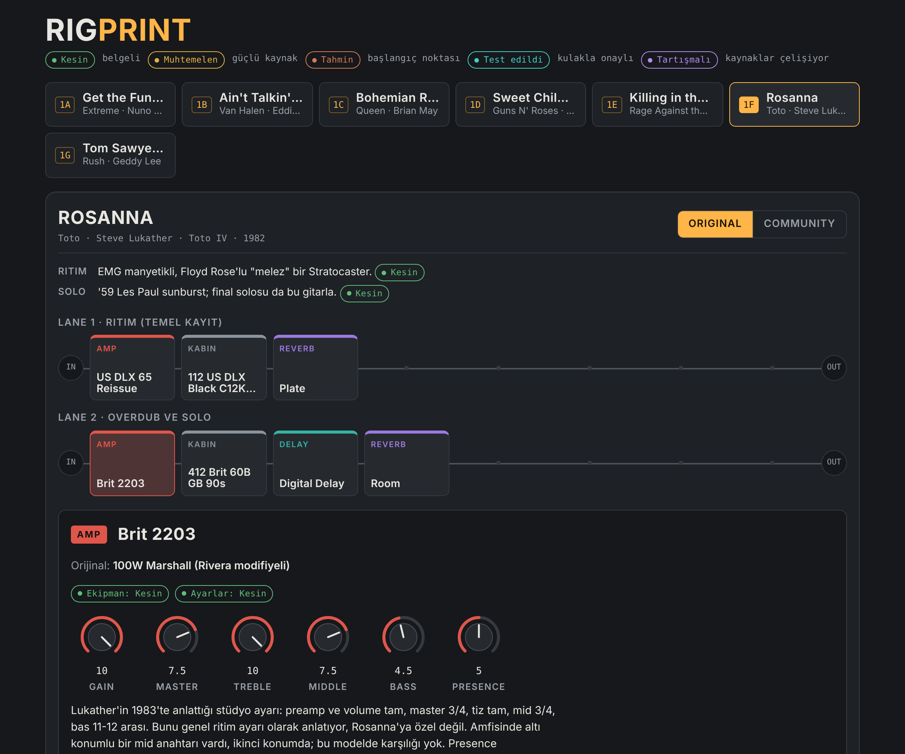

# RigPrint

**Bir şarkının gitar tonunu Quad Cortex rig'ine çeviren ücretsiz bir Claude skill'i.**

"Bana Rosanna'nın tonunu ver" dersin; RigPrint kaynakları araştırır, orijinal ekipmanı ve topluluğun kayda benzettiği tarifi Quad Cortex cihaz adlarıyla çıkarır ve hepsini tıklanabilir bir sayfa olarak verir.



[Kurulum](#kurulum) · [ChatGPT](#chatgptde) · [Kullanım](#kullanım) · [Güven etiketleri](#güven-etiketleri) · [Sınırlar](#sınırlar) · [Lisans](#lisans) · [English](#english)

---

## Ne yapar

- **Kaynağa göre araştırır.** Önce gitaristin kendi röportajlarına, sonra ekipmanı belgeleyen sitelere, en son topluluk tariflerine bakar. Ücretli preset paketlerinin içeriğini kopyalamaz.
- **İki versiyon çıkarır.**
  - **Original:** kayıtta kullanılan ekipmanın Quad Cortex karşılığı.
  - **Community:** toplulukta kayda benzediği kabul edilen tarif. Plaktaki ses miks EQ'su, kompresör ve stüdyo efektlerinden geçtiği için çoğu zaman ikisi farklı çıkar.
- **Quad Cortex'in gerçek cihaz adlarını kullanır.** Neural DSP'nin cihaz listesinden derlenmiş bir sözlükle çalışır; QC'de olmayan bir cihaz uydurmaz.
- **Sayfa olarak verir.** Sinyal zinciri Quad Cortex arayüzüne benzer bir ızgarada görünür. Bir bloğa tıklayınca ayarları, orijinal ekipmanı ve güven etiketini görürsün. Aynı sohbette istediğin her şarkı üstteki listeye eklenir.
- **Benzer şarkılar önerir.** Aynı rig'le çalınabilecek 2-3 şarkı.

## Kurulum

1. Bu repodaki [`rigprint.zip`](rigprint.zip) dosyasını indir. Açma, ZIP olarak kalsın.
2. [claude.ai](https://claude.ai)'da **Customize > Skills** bölümüne git, **+** düğmesine bas, **Create skill > Upload a skill** seç ve ZIP'i yükle.
3. İki ayarın açık olduğundan emin ol:
   - **Settings > Capabilities > Create and edit files** (kod çalıştırma)
   - **Web search** (sohbet kutusundaki araçlar menüsünden)

Skill'ler Free, Pro, Max, Team ve Enterprise planlarında yüklenebiliyor. Team ve Enterprise'da yönetici bu özelliği kapatmış olabilir.

> Her şarkı çok sayıda arama ve sayfa okuması demek. Free planda birkaç şarkıdan sonra kullanım limitine takılabilirsin.

### ChatGPT'de

RigPrint Claude için yazıldı ve ChatGPT'de test edilmedi; sonuç farklı olabilir. Skill dosyası açık bir formatta (`SKILL.md`), ChatGPT'de iki yolla kullanılabilir:

- **Skills özelliği olan hesaplarda** (Business, Enterprise ve Edu; Free, Plus ve Pro'da henüz yok): ChatGPT'nin Skills bölümünden "upload" seçeneğiyle `rigprint.zip` ya da `skill/SKILL.md` dosyasını yükle. Kurumsal hesaplarda yöneticinin Skills'i açmış olması gerekir.
- **Diğer bütün planlarda, Project ile:**
  1. Sol menüden **Projects > New project** ile bir proje aç.
  2. Bu repodaki [`skill/SKILL.md`](skill/SKILL.md) dosyasını projenin dosyalarına ekle.
  3. Proje talimatlarına şunu yaz: *"Bir şarkının ya da gitaristin tonu istendiğinde proje dosyalarındaki SKILL.md'yi (RigPrint) adım adım uygula."*
  4. Web aramasının açık olduğundan emin ol ve sohbeti bu projenin içinde başlat.

ChatGPT'de sayfa genellikle bir HTML dosyası olarak gelir; indirip tarayıcıda açarsın.

## Kullanım

Yeni bir sohbet aç ve doğal dille iste:

```
Bana Sweet Child O' Mine'ın tonunu ver.
```

```
Killing in the Name'in riff tonu. Gitarım Telecaster, köprüde single coil.
```

- **Gitarını söylersen** RigPrint ayarları ona göre uyarlar; bloğa tıklayınca altta "Senin gitarın" notu çıkar.
- **Aynı sohbette başka şarkı istersen** aynı sayfaya eklenir: 1A, 1B, 1C…
- **Preset'i cihazda kurup denedikten sonra** sonucu yaz, örneğin "Gain 5 oldu, chorus'u kapattım". RigPrint değerleri günceller ve o blokları **Test edildi** olarak işaretler.
- **Cihaz ekranında farklı görünen bir parametre adı ya da birim varsa** söyle ya da ekran görüntüsünü at. Cihazdan gelen bilgi her kaynağın önüne geçer.

Her cevabın sonunda kullanılan kaynakların listesi ve Cortex Cloud'a yüklemek için hazır bir ad ile açıklama gelir.

### Cortex Cloud'da ortak kütüphane

RigPrint, preset adını hep aynı biçimde önerir:

```
DS RigPrint · Şarkı adı
```

Test ettiğin preset'leri bu adla Cortex Cloud'a yüklersen, Cortex Cloud'da "DS RigPrint" diye arayan herkes test edilmiş bütün RigPrint preset'lerini bir arada bulur.

## Güven etiketleri

Her blokta iki etiket var: ekipmanın ve ayarların ne kadar sağlam olduğu.

| Etiket | Anlamı |
| --- | --- |
| **Kesin** | Gitaristin kendisinden ya da belgeli bir kaynaktan |
| **Muhtemelen** | Güçlü kaynak ya da örtüşen birden fazla tarif |
| **Tahmin** | Başlangıç noktası; kulakla düzelt |
| **Test edildi** | Kullanıcı cihazda kurup onayladı |
| **Tartışmalı** | Kaynaklar birbiriyle çelişiyor; iki taraf da notta yazıyor |

## Sınırlar

- **Bir başlangıç noktasıdır, birebir kopya değil.** Ton parmakta, gitarda ve kayıtta. Değerleri kulakla düzelt.
- **Parametre adları ve birimleri her zaman doğrulanamıyor.** Neural DSP cihaz bazında parametre listesi yayınlamıyor. RigPrint doğrulayabildiğini cihazdaki adıyla ve birimiyle yazıyor; doğrulayamadığını işaretliyor.
- **Quad Cortex'e otomatik yükleme yok.** Neural DSP preset dosyası dışa aktarmaya ya da Cortex Cloud'a dışarıdan erişime izin vermiyor. Preset'i cihazda ya da Cortex Control'de kendin kurarsın.
- **Synth tonları için Mono Synth kullanılır** (CorOS 3.3.0 ve sonrası). Mono Synth tek nota takip eder, akor takip etmez.
- **Cihaz sözlüğü CorOS 4.1.0 dönemine göre.** Sonraki güncellemelerle gelen cihazlar sözlükte olmayabilir.

## Katkı

Bir değer cihazda kayda benzemediyse ya da bir parametre adı yanlışsa [issue](../../issues) aç. Cihaz ekranının fotoğrafını eklersen sözlük o cihaz için kesinleşir.

## Repo içeriği

| Dosya | Ne |
| --- | --- |
| `rigprint.zip` | Claude'a yüklenecek skill |
| `skill/SKILL.md` | Skill'in okunabilir kaynağı (ZIP'in içindekiyle aynı) |
| `assets/` | README görselleri |
| `LICENSE` | CC BY-NC 4.0 lisans metni |

## Lisans

[CC BY-NC 4.0](https://creativecommons.org/licenses/by-nc/4.0/). Ücretsiz kullanabilir, değiştirebilir ve paylaşabilirsin. İki şart var: kaynağı belirt ve ticari amaçla kullanma; satma, ücretli bir ürüne ya da hizmete dahil etme. Tam metin [`LICENSE`](LICENSE) dosyasında.

Bu proje Neural DSP ile bağlantılı değildir. Quad Cortex, Cortex Cloud ve Cortex Control, Neural DSP Technologies'in markalarıdır. Şarkı, sanatçı ve ekipman adları yalnızca tanımlama amacıyla kullanılır.

---

## English

**RigPrint** is a free Claude skill that turns a song's guitar tone into a Neural DSP Quad Cortex rig.

- **Research:** It looks in the guitarist's own interviews first, then gear documentation, then community recipes.
- **Two versions:** **Original** is the recorded gear mapped to QC devices. **Community** is the recipe that sounds like the record.
- **Output:** An interactive page with confidence labels on every block.
- **Language:** The skill answers in Turkish.

**Install:**
1. Download [`rigprint.zip`](rigprint.zip).
2. On claude.ai, go to **Customize > Skills > + > Create skill > Upload a skill**.
3. Turn on **Settings > Capabilities > Create and edit files**, and make sure **web search** is enabled in the chat.

**ChatGPT:** Untested. On plans with ChatGPT Skills (Business, Enterprise, Edu), upload `rigprint.zip` or `skill/SKILL.md`. On other plans, create a Project, add `skill/SKILL.md` as a project file, and tell the project to follow it when a tone is requested.

**License:** [CC BY-NC 4.0](https://creativecommons.org/licenses/by-nc/4.0/). Free to use, adapt and share with attribution; no commercial use. Not affiliated with Neural DSP.

---

Bu bir [Slap Studio](https://www.ssslap.com) güzelliğidir. Yapım hikâyesi YouTube'da: [@diclesozbir](https://www.youtube.com/@diclesozbir)
